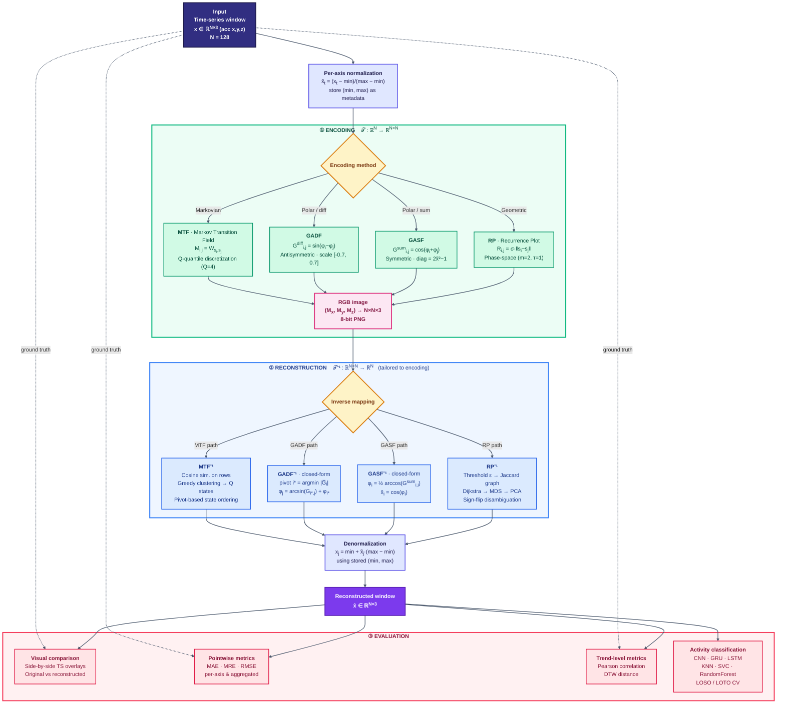
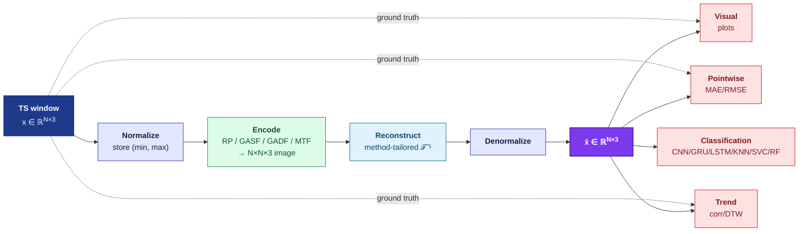
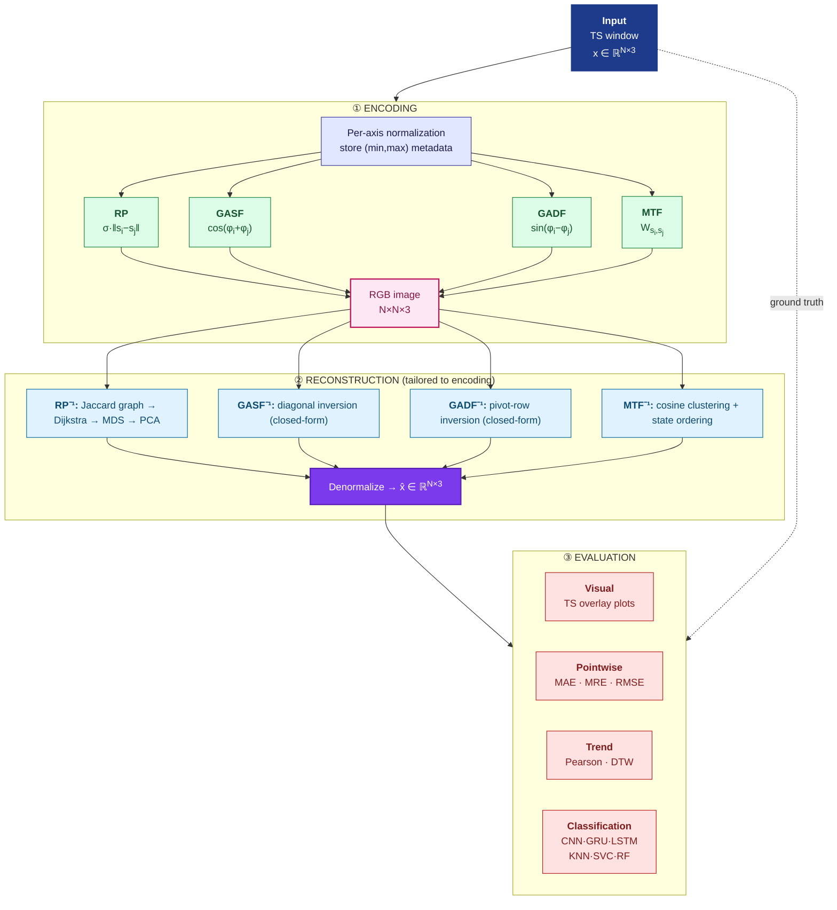

# Workflow Overview — Diagrama Mermaid

> Diagrama de flujo del pipeline propuesto: codificación de cada ventana de serie temporal como imagen, reconstrucción con un método específico para cada codificación, y evaluación mediante comparación visual, métricas puntuales, métricas de tendencia y desempeño de clasificación de actividad.

---

## Versión 1 — Diagrama completo agrupado por etapas (recomendado para el paper)



---

## Versión 2 — Compacta para figura de paper (left-right, una sola codificación a modo de ejemplo)



---

## Versión 3 — Subgrupos (para enfatizar las 3 etapas del pipeline)



---

## Cómo exportar a PNG para LaTeX

Para incluir el diagrama en el paper como `images/workflow_overview.png`:

**Opción A — Mermaid CLI (recomendado):**
```bash
npm install -g @mermaid-js/mermaid-cli
mmdc -i workflow_overview.md -o images/workflow_overview.png -w 1920 -H 1080 -b transparent
```

**Opción B — Online:** copiar el bloque mermaid a https://mermaid.live, exportar como PNG/SVG.

**Opción C — VS Code:** instalar la extensión *Markdown Preview Mermaid Support* y hacer captura del preview.

Para la figura del paper se recomienda la **Versión 3 (con subgrupos)** porque explicita las tres etapas del pipeline anunciadas en el caption y permite que cada método de codificación y reconstrucción quede visualmente vinculado a su etapa correspondiente.
